# MoleditPy ORCA Result Analyzer Plugin

[](https://doi.org/10.5281/zenodo.20726011)
[](https://github.com/HiroYokoyama/moleditpy_orca_result_analyzer_plugin/actions/workflows/tests.yml)
[](https://codecov.io/gh/HiroYokoyama/moleditpy_orca_result_analyzer_plugin)
[](https://github.com/HiroYokoyama/python_molecular_editor)
[](https://github.com/sponsors/HiroYokoyama)
[](https://github.com/HiroYokoyama/moleditpy_orca_result_analyzer_plugin/tags)
[](https://github.com/HiroYokoyama/moleditpy_orca_result_analyzer_plugin/releases)

A plugin for MoleditPy that reads ORCA output (`.out`) and presents it as analysis
windows: orbitals, vibrational modes, spectra, charges, bonding and optimization
paths.

This plugin is an independent project and is not affiliated with or endorsed by the
ORCA developers or FACCTs. You need your own copy of ORCA to produce the files it
reads.

## Screenshots

The analyzer works beside the MoleditPy window rather than inside a viewer of its
own. Pick an orbital, a normal mode or an optimization step, and MoleditPy's 3D view
follows: orbitals as isosurfaces, modes as arrows and animation, steps as geometries.

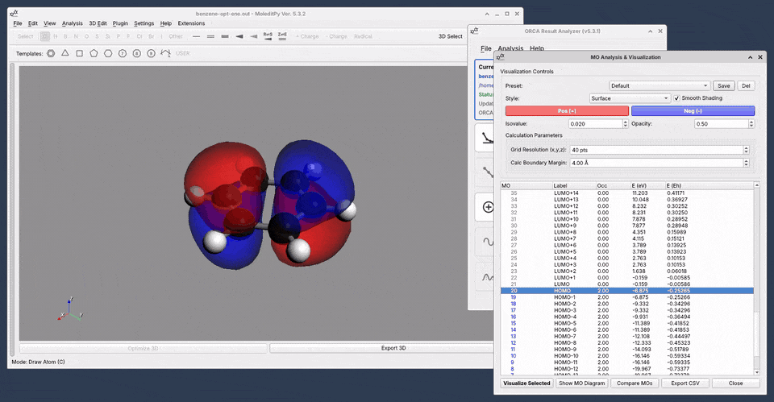

| Normal mode animation | Optimization playback |
|---|---|
| 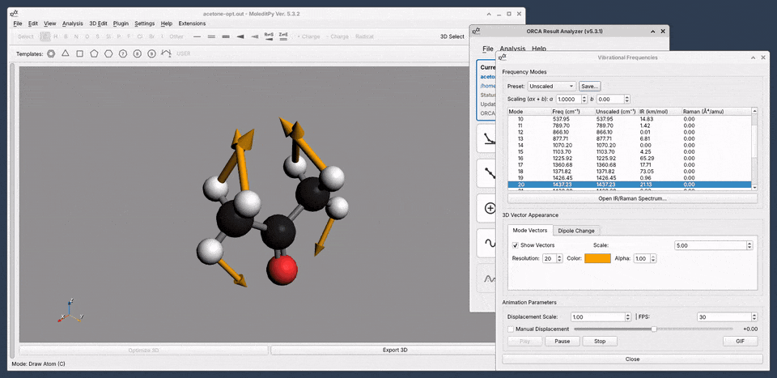 | 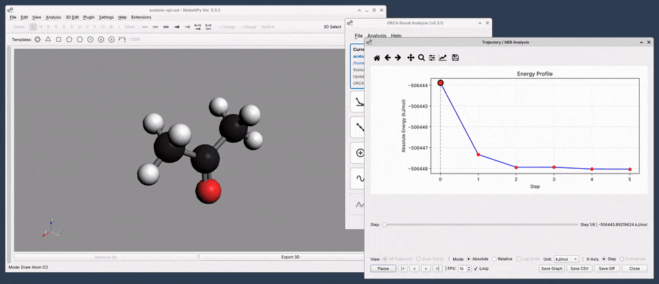 |

**Main window**: one button per analysis, enabled when the output holds the data.

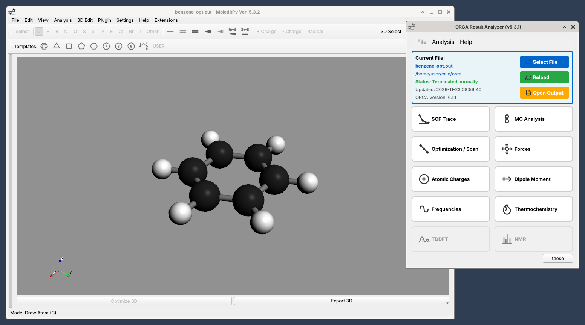

| Molecular orbitals | Compare MOs |
|---|---|
| 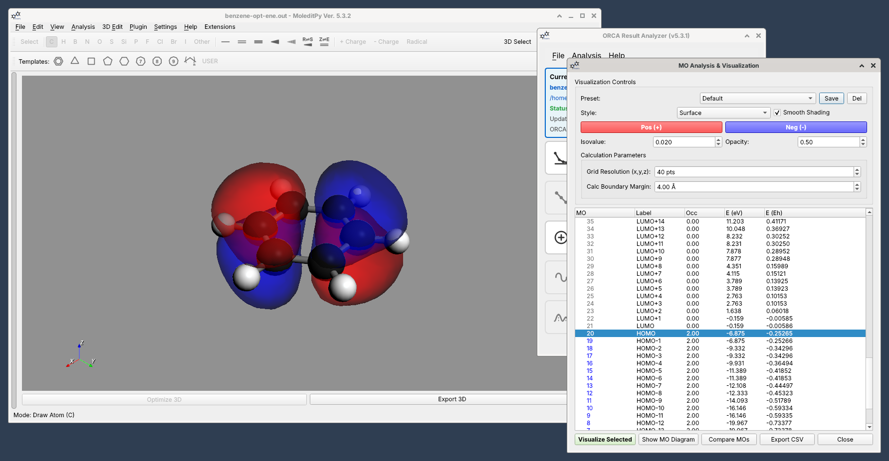 | 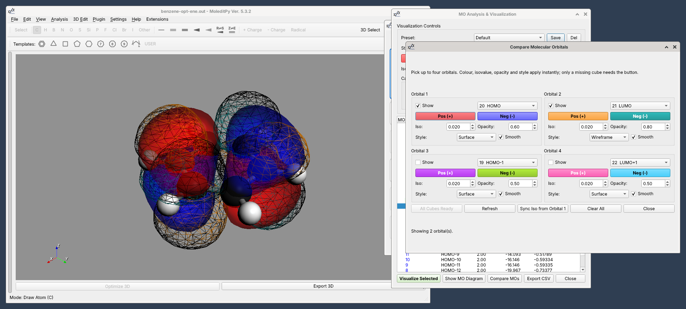 |

| Frequencies | Atomic charges |
|---|---|
| 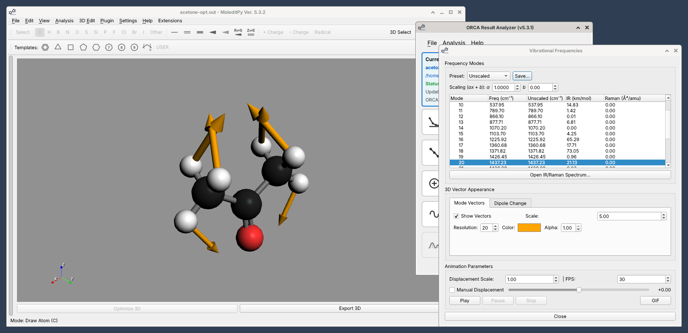 | 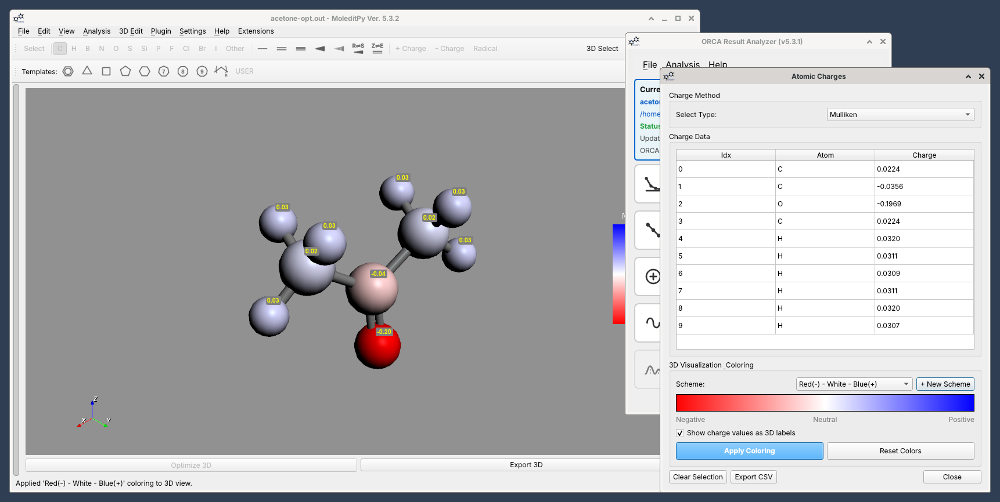 |

| Optimization | TD-DFT |
|---|---|
|  | 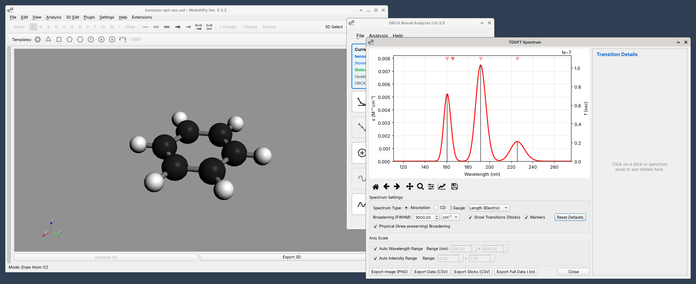 |

| NMR | Convergence thresholds |
|---|---|
| 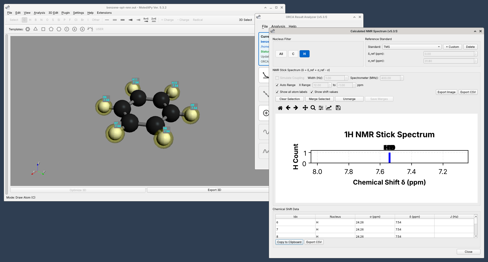 | 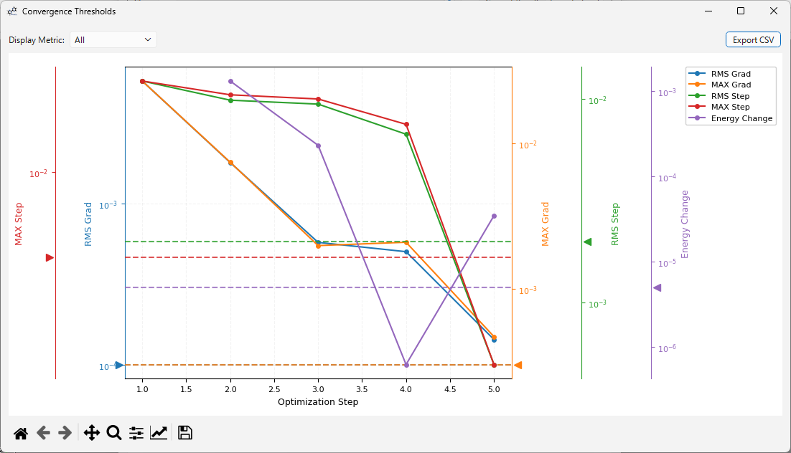 |

All taken with MoleditPy 5.3.2 from the jobs in `tests/sample_outputs`, except the
convergence-threshold graph.

## Features

- **SCF trace**: energy against iteration, all SCF cycles of the job as one continuous plot.
- **Molecular orbitals**: energy levels with HOMO/LUMO marked, and 3D isosurfaces with
  s to g shells, smooth shading and saved color presets. **Compare MOs** shows up to
  four orbitals in one view, each with its own colors, isovalue, opacity and style,
  and generates missing cubes on demand; **Sync Iso** puts every slot on Orbital 1's
  contour level.
- **Optimization and scan**: energy against step or scanned coordinate, absolute or
  relative, in kJ/mol, kcal/mol, eV or Eh, with an optional log scale. Click a point
  to show that geometry; play the path and export it as a GIF.
- **Forces**: gradient vectors for every step, with auto scaling, and RMS/MAX gradient
  and step against ORCA's criteria. **Shift+Click** on Forces opens the convergence
  threshold graph directly.
- **Atomic charges**: Mulliken, Loewdin, Hirshfeld, Mayer, CHELPG, MBIS, RESP and NBO,
  shown as atom colors and labels in the 3D view.
- **Dipole moment** as a vector on the structure.
- **Frequencies**: normal modes with IR intensities and Raman activities, animated with
  displacement vectors; stick and broadened IR/Raman spectra; GIF export.
- **Thermochemistry**: electronic energy, ZPE, enthalpy and Gibbs energy, with optional
  vibrational, rotational and translational contributions, in Eh, kcal/mol, kJ/mol or eV.
- **TD-DFT**: excited states with simulated absorption and CD spectra.
- **NMR**: shieldings as stick spectra per nucleus against TMS, CDCl3, DMSO-d6 or custom
  references, J-coupling multiplets when ORCA prints the couplings (needs `nmrsim`),
  merging of equivalent atoms, and two-way highlighting between peaks and atoms.
- **Bond analysis**: Mayer bond orders, NBO orbitals with hybridization, and E(2)
  donor-acceptor energies; selecting a row highlights its atoms.
- **Post-HF energies and properties**: reference, MP2/CCSD correlation and (T) energies,
  <S**2>, dispersion corrections.
- **NICS** (optional): **Analysis > NICS Analysis...** passes the open file to the
  ORCA NICS Analyzer plugin when it is installed.

Open a file through **File > Open**, by dropping it on MoleditPy or the analyzer
window, or from **Extensions > ORCA Result Analyzer**. Dropping a folder opens a
picker of the outputs in it. All analysis windows are modeless, tables copy with
`Ctrl+C`, and presets, NMR references and saved merges are remembered.
Shortcuts: `Ctrl+O` open, `Shift+Ctrl+O` select from directory, `Ctrl+R` reload,
`Ctrl+W` close.

## Keywords to request from ORCA

Geometries and energies need nothing extra. Orbitals in 3D need the basis set and
MO coefficients:

```text
%output
  Print[P_Basis] 2  # Required for Basis Set parsing
  Print[P_Mos] 1    # Ensure MO coefficients are printed
end
```

J-coupling multiplets in NMR need the couplings:

```text
! NMR

%eprnmr
  NUCLEI = ALL H {SHIFT, SSALL} # Required for J-coupling (nmrsim)
end
```

## Command line

The analyzer also runs without a window, so a
script, a batch job or a remote shell can read an output file directly. No
editor and no Qt window is opened.

```bash
moleditpy -r orca_result_analyzer parse job.out                 # summary
moleditpy -r orca_result_analyzer parse job.out --json          # every parsed value, as JSON
moleditpy -r orca_result_analyzer parse job.out --json -s thermal -s frequencies
moleditpy -r orca_result_analyzer xyz job.out -o final.xyz      # final structure
moleditpy -r orca_result_analyzer xyz job.out --all -o path.xyz # every step, one frame each
```

`moleditpy -r` needs MoleditPy 5.3.0 or later. `-r` is short for
`--run-plugin`; `moleditpy --list-plugins` shows the installed
plugins that can be run this way. `python -m` works just as well, from the
folder that contains the `orca_result_analyzer` folder (your plugins folder, or a checkout of
this repository), with the Python MoleditPy is installed in, and needs no
MoleditPy launcher:

```bash
python -m orca_result_analyzer parse job.out
```

`FILE` is an ORCA output file (`.out`).

| Command | What it does |
|---|---|
| `parse FILE` | Prints a summary: program version, termination, formula, charge and multiplicity, SCF energy, <S**2>, HOMO/LUMO gap, dipole, steps and whether an optimisation converged, frequencies with the number of imaginary modes, Gibbs energy, excited states, NMR, charges and NBO, each only when the file has it. The last line lists the sections present. |
| `parse FILE --json` | Prints the parsed data the analysis windows read, as JSON. `-s NAME` (repeatable) keeps only those top-level sections; `--indent N` sets the indent. |
| `xyz FILE` | Writes the final structure as XYZ in Angstrom, with the SCF energy in the comment line. |
| `xyz FILE --all` | Writes a multi-frame XYZ: the points of a scan or IRC, otherwise every optimisation cycle, each with its energy in the comment line. |

Every command takes `-o PATH` to write a file instead of standard output.
The exit status is 0 on success, 1 when the file cannot be read, is not ORCA
output or has nothing to write, and 2 for a usage error such as an unknown
section.

## Installation
Download from [Plugin Explorer](https://hiroyokoyama.github.io/moleditpy-plugins/explorer/?q=ORCA+Result+Analyzer).  

Ensure the `orca_result_analyzer` folder is placed in your MoleditPy plugins directory.

## Requirements
- **MoleditPy**: Version 5.0.0 or higher, below 6.0.0.
- **ORCA Output**: Reads `.out` files. Basis set info (`Print[P_Basis] 2`) is required for MO Cube generation.
- **Dependencies**: `rdkit`, `matplotlib`, `Pillow` (PIL), and `pyvista` (for 3D vectors). `nmrsim` is optional (for J-coupling simulation). 

## Development

Run the test suite with `python run_tests.py` (it forwards any pytest
arguments). Use that wrapper rather than calling `pytest` directly — it
disables third-party plugin autoload so local runs match CI.

Tests run on Python 3.9–3.13 with no Qt binding installed; the dialogs are
exercised headlessly through `tests/gui_harness.py`. CI reports coverage on
every run, with a target of **above 80%**.

See [tests/README.md](tests/README.md) for how the suite is organised, the Qt
harness, and the sample ORCA files it parses; [CONTRIBUTING.md](CONTRIBUTING.md)
for the contribution workflow.

[docs/MO_CALCULATION.md](docs/MO_CALCULATION.md) documents how molecular
orbitals are evaluated — basis-function normalization, the spherical-harmonic
component tables, and how to verify a change to them numerically rather than
by eye. Read it before touching `mo_engine.py`.

## License Note on Sample Output Files

The test fixtures in `tests/sample_outputs/` are ORCA quantum chemistry output files (`.out`) generated by running [ORCA](https://orcaforum.kofo.mpg.de/) on publicly available molecular geometries (benzene, acetone).

ORCA is proprietary software distributed free for academic use under its own license. These output files are included solely as test fixtures for the parser. They are **excluded from this project's LGPL-3.0-or-later license** — they are not source code of this project and carry no additional redistribution grant beyond what the general scientific community norm considers acceptable for test data.

If you need to regenerate these files, you will need your own ORCA installation.

## License & Disclaimer

This project is licensed under the GNU Lesser General Public License v3.0 (LGPLv3) - see the [LICENSE](LICENSE) file for details. As open-source software, it is provided 'as is' without warranty of any kind, and the author assumes no responsibility or liability for the results. Although outputs have been carefully verified, users are strongly encouraged to independently check and validate them for critical applications (such as publications). If you encounter any bugs, please open an issue.


## Licensing scope

First-party code in this migration is LGPL-3.0-or-later. See [LICENSE](LICENSE), [COPYING](COPYING) and [dependency/provenance terms](LICENSING.md). Third-party components and historical releases retain their own terms.
